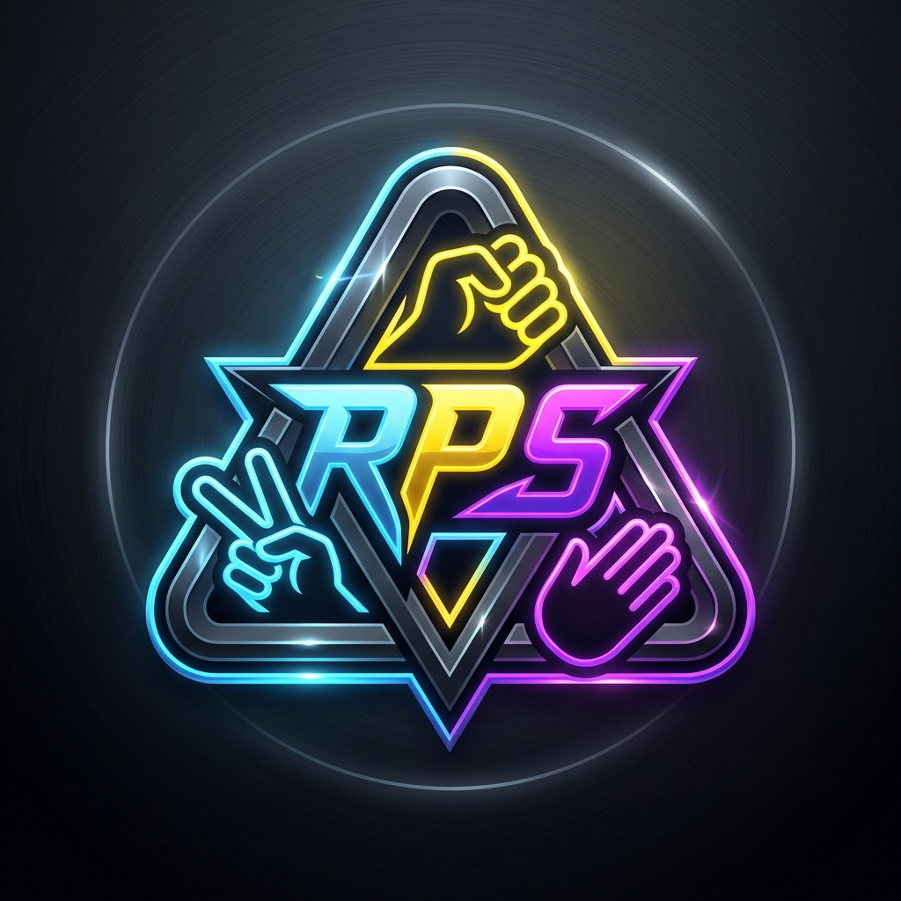

<div align="center">
  
  <h1>🎮 Rock Paper Scissors Engine</h1>
</div>

[](https://github.com/SahilKhatkar11/rps-game/actions/workflows/deploy.yml)
[](https://react.dev/)
[](https://vitejs.dev/)
[](https://tailwindcss.com/)
[](https://www.typescriptlang.org/)
[](LICENSE)

> An adaptive Rock Paper Scissors web application powered by intelligent client-side Python algorithmic strategies, real-time statistical tracking, and synthesized retro Web Audio effects. Built with React and Tailwind CSS, it features an iOS-inspired liquid glass interface, zero-scroll responsive layout, tournament series modes, customizable match targets, and an interactive Python decision inspector providing an engaging, modern gaming experience.

---

## 🌐 Live Demo

Try the live version of the app here:  
👉 [RockPaperScissors Game Live](https://sahilkhatkar11.github.io/rps-game/)

No installation required — just open the link and start using the app instantly.

---

## ✨ Features

- 🧠 **Adaptive AI Strategies**:
  - **Markov Chain**: 2nd-order transition matrix tracking human pattern recognition and predictive countering.
  - **Win-Stay Lose-Shift**: Behavioral game theory strategy modeling real-world psychology.
  - **Frequency Counter**: Tracks human choice frequency bias and exploits overused moves.
  - **Nash Equilibrium (Pure Random)**: Cryptographically uniform randomization.
- 🔬 **Live Algorithm Logic Panel**: View real-time Python decision traces, transition matrices, and algorithm explanations right inside the game.
- 🪟 **iOS Liquid Glass Interface**: Translucent frosted glass containers with multi-tier backdrop blur, specular light rims, and smooth micro-interactions.
- 📱 **Zero-Scroll Single-Page Design**: Viewport-adaptive layout engineered to fit seamlessly on any display size (mobile, tablet, desktop) without page scrolling.
- 🔊 **Built-in Web Audio Synthesizer**: Sound effects (countdown ticks, selections, victory fanfares, and tie beeps) synthesized in real time via the Web Audio API—no external audio files required.
- 📊 **Match & Series Tracking**: Customizable series goals (First to 3, 5, 10, or Endless), win streaks, match champion cards, and clearable history logs.
- ⚡ **Instant Client-Side Execution**: Runs entirely in-browser with zero server latency, local storage persistence, and immediate interactive feedback.

---

## 🛠️ Tech Stack

| Technology | Purpose |
| :--- | :--- |
| **React 19** | Modern component-driven UI architecture |
| **TypeScript** | Type-safe state, configuration, and algorithm models |
| **Vite 6** | Ultra-fast build tool and development server |
| **Tailwind CSS 4** | Utility-first styling with custom glassmorphism and animations |
| **Web Audio API** | Real-time procedural sound synthesis |
| **Canvas Confetti** | Dynamic celebratory particle effects |
| **Lucide React** | Minimalist UI iconography |

---

## 🚀 Getting Started

### Prerequisites

- **Node.js**: v18.0.0 or higher
- **npm**: v9.0.0 or higher

### Installation

1. Clone the repository:
   ```bash
   git clone https://github.com/SahilKhatkar11/rps-game.git
   cd rps-game
   ```

2. Install dependencies:
   ```bash
   npm install
   ```

3. Start the local development server:
   ```bash
   npm run dev
   ```
   Open [http://localhost:3000](http://localhost:3000) (or the port displayed in your terminal) in your browser.

---

## 📦 Building for Production

Compile the project into a static web bundle:

```bash
npm run build
```

This compiles optimized static assets into the `dist/` directory and creates `dist/404.html` to support direct SPA routing on static hosts.

To preview the production build locally:

```bash
npm run preview
```

---

## 👨‍💻 Author

Crafted with Passion by **[Sahil Khatkar](https://github.com/SahilKhatkar11)**

---

## 📄 License

This project is licensed under the [Apache License 2.0](LICENSE).
